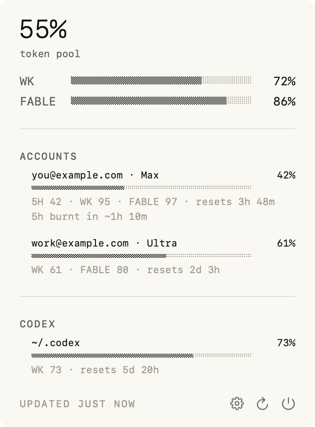
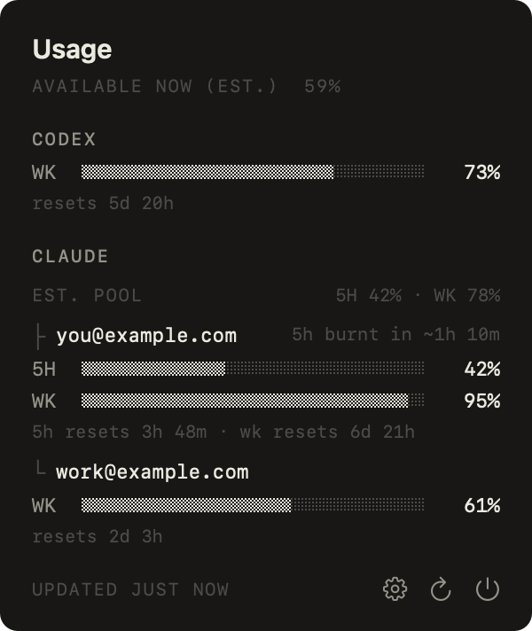
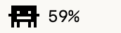
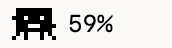

# QuotaTracker

Native macOS menu-bar monitor for Claude and Codex quota remaining.

<p>
  
  
</p>

## Install

```sh
git clone https://github.com/CharlesSOo/tokenspender.git
cd tokenspender
./install.sh
```

macOS 14+ and Xcode Command Line Tools. Installs to `/Applications` and starts at login.

## How it works

Reads the credentials your CLIs already have (Claude Code, Codex CLI) and asks each provider for remaining quota. Credentials are only sent to their provider. Codex access tokens renew automatically; rotated credentials are saved back to `~/.codex/auth.json` with owner-only permissions.

Each Claude Code config folder is one account row with its current plan: `~/.claude`, every `~/.claude-*` with a `.claude.json`, `$CLAUDE_CONFIG_DIR`, and any folder added under Settings → Add Claude folder…. When a Claude login has expired, QuotaTracker runs `claude -p /usage` for that folder (no model call, at most every 10 minutes) so Claude Code renews it; if that fails the row keeps its last numbers, dimmed, with a hint to run `claude` there. Which limits show (5-hour, weekly, per-model) comes from the server each poll.

All Claude accounts form one pool, shown as `CLAUDE POOL · 20× Pro`: each account counts by its plan's weekly capacity (Pro 1, Max 5, Ultra 10; an unknown plan counts 1 and the pool is marked EST.). NOW is the weighted mean of each account's lower of 5-hour and weekly quota left (no 5-hour limit counts as 100%); the weekly line and each per-model weekly limit get their own line. The menu-bar number is the pool's NOW, an estimate rather than a shared token balance; Settings can switch it to Codex or a single account. Per-account bars and reset times follow below the pool. The animation reacts to session-log activity, not measured token spend. Offline, each row keeps its last good numbers (dimmed, saved across launches, no tokens stored) and refreshes when the network returns.

## Design

A single percentage in the menu bar, a little guy who eats and dances while you work. Light and dark follow the system.


| Eating | Dancing |
|---|---|
|  |  |

## Footprint

Pure AppKit. ~450 KiB bundle, ~20 MiB settled memory, 0% idle CPU.

MIT. Provider parsing adapted from [CodexBar](https://github.com/steipete/CodexBar), see [THIRD_PARTY_NOTICES.md](THIRD_PARTY_NOTICES.md). Not affiliated with Anthropic or OpenAI.
